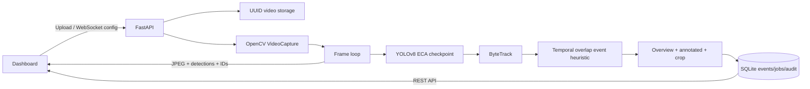

# MVP architecture

## Model contract

The supplied checkpoint contains four classes: `Motorcyclist`, `Plate`, `Helmet`, `Non_helmet`. `model_runtime.py` restores the serialized `ECAAttention` class path needed by the checkpoint. Inference uses GPU 0 when CUDA is available and CPU otherwise; Ultralytics ByteTrack assigns temporary IDs. A single inference lock prevents tracker state from leaking between simultaneous stream requests.

The event rule associates a `Non_helmet` box with a `Motorcyclist` box when its center is contained by that box. The same tracked box must meet this condition for a configured number of consecutive frames. An event is created with `needs_review`; it is not a legal finding. The geometry can be wrong for overlapping riders, passengers, occlusion, or poor camera angles.

## Stream lifecycle

Upload is stored under a random job UUID; user file paths are never opened directly. A WebSocket binds to an upload job, webcam index, or RTSP URL. OpenCV reads a frame, model inference/tracking and event checks run, and annotated JPEG plus detection metadata is sent to the browser. Stop/disconnect reaches a `finally` block that releases `VideoCapture` and the inference lock. Live sources retry at most five times with bounded backoff; concurrent streams are rejected.

The current loop is sequential and sends every processed frame. It does not yet have a separate durable worker queue, stream pause/resume, or per-camera concurrent GPU scheduler.

## Evidence and audit

An event stores a unique event ID, UTC timestamp, source label, confidence, temporary track/session IDs, model filename/labels, and three JPEG paths. Evidence is retrieved only by event ID and a fixed image kind; path traversal is not accepted. Reviewer updates store status/note and an audit record. SQLite is suited to this single-machine MVP, not multi-user deployment.

## Next production steps

- Add authentication, role authorization, CSRF/origin policy, audit actor identity, and controlled evidence download.
- Add retention/deletion, privacy review, optional redaction, and deployment-specific access safeguards.
- Evaluate model and event precision/recall on authorized, camera-disjoint data; tune thresholds from measured results.
- Add a bounded durable worker queue, per-camera state, reconnection policy tests, and backpressure for long videos.
- Validate legal requirements and data handling before operational use. Keep a human review step.
